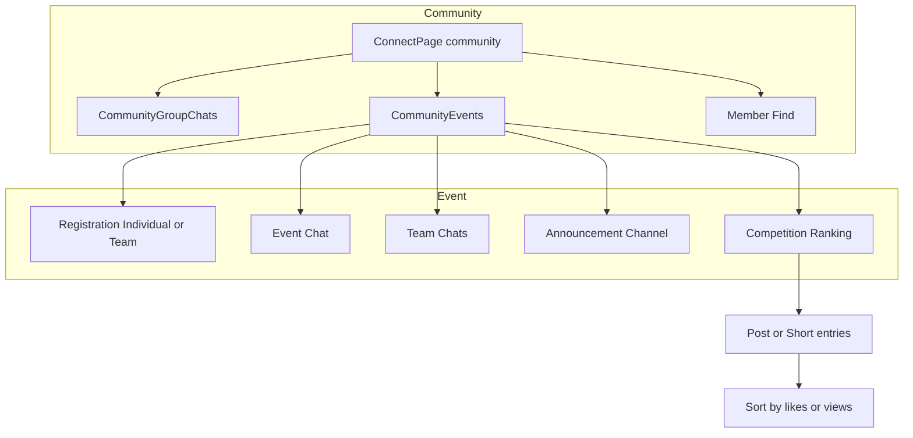

# Community Groups & Events + Event Competition Rankings

**Plan heading (all features):** Community Overview & Creation · Navigation (Group Chats / Events / Find) · Multi Group Chats (Public / Request+Proof / Invite-Only) · Events CRUD · Participation Modes (Individual / Team / Both) · Event Chat · Event-Scoped Private Chat · Team Event Chats + Announcements · Community Find · Roles (Owner / Admin / Moderator) · **Event Competition Rankings** (host criteria likes|views, join rules, post/short submissions, team full-roster join, host remove+resubmit with fresh counts)

**Scope default:** This plan covers **Community Groups & Events** from [Tool/CR's/Community/TAATOM_Crs.pdf](Tool/CR's/Community/TAATOM_Crs.pdf) (pp. 4–8) **plus** your Event Competition Ranking extras. The same PDF also contains Long Video monetization and Global Trip Score Ranking & Awards — those are **out of scope here** (Long Video largely exists; Global Ranking is a separate product).

**Foundation to reuse (not rebuild):** Connect pages, follows, members, and one page-level group chat already exist ([ConnectPage](backend/src/models/ConnectPage.js), [connectController](backend/src/controllers/connectController.js), [Chat `connect_page`](backend/src/models/Chat.js), [group-info](frontend/app/chat/group-info.tsx), [web connect page](web/app/(dashboard)/connect/page/[id]/page.tsx)). This plan **extends** that into multi-chat communities + events + competitions.

---

## Phase 0 — Domain model & API contracts

New backend models (suggested under `backend/src/models/`):

- **`CommunityGroupChat`** — `connectPageId`, `name`, `description`, `privacy` (`public` | `request` | `invite`), `requireJoinProof` (bool + proof prompt text), `chatId` → Chat, `createdBy`, `memberCount`
- **`CommunityGroupJoinRequest`** — user, groupChatId, optional `proof` (text/file URL), status
- **`CommunityEvent`** — pageId, title, description, start/end, location, cover, `maxParticipants`, `visibility`, `participationMode` (`individual` | `group` | `both`), `hostIds[]`, registration open/closed, `chatId` (event-wide), `announcementChatId`
- **`CommunityEventRegistration`** — eventId, mode (`individual` | `team`), userId or `teamId`, status
- **`CommunityEventTeam`** — eventId, name, captainId, `memberIds[]` (all must be Taatom users + community members), join completeness flag
- **`CommunityEventCompetition`** (your extras) — eventId, enabled, `rankBy` (`likes` | `views`), `allowedMedia` (`post` | `short` | `both`), submission window, rules text; host-only settings
- **`CommunityEventSubmission`** — competitionId, registrant (user or team), `postId`, status (`active` | `removed_by_host`), counts snapshot + live counts; host remove forces new upload with **fresh** like/view counts (new postId only)
- Chat extensions: Chat `type` adds `community_group` | `community_event` | `community_event_team` | `community_event_dm` so these **never** land in the normal inbox list (filter in [chat.controller.js](backend/src/controllers/chat.controller.js) list endpoints)

Roles (PDF): Owner (existing page owner), **Administrators (unlimited)** on community (extend beyond current max-2 chat co-admins), **Moderators** (new) — events/chats moderation without full ownership. Keep page-chat co-admin cap for the **legacy page group chat**; community-level admin is a separate `CommunityRole` collection or `ConnectPage.admins[]`.

---

## Phase 1 — Community shell (nav + creation upgrades)

**Backend:** Ensure community create fields match PDF: name, description, profile pic, cover, privacy. Map onto existing Connect create in [connectController.js](backend/src/controllers/connectController.js) / [frontend/app/connect/create.tsx](frontend/app/connect/create.tsx).

**App + Web community home** (extend [frontend/app/connect/page/[id].tsx](frontend/app/connect/page/[id].tsx) and [web/.../connect/page/[id]/page.tsx](web/app/(dashboard)/connect/page/[id]/page.tsx)):

- Tabs: **Group Chats | Events | Find**
- Owner/Admin: create chat, create event, manage roles
- Member: join flows, browse events, Find members

**Find:** community-scoped member search (followers of page / role holders only) — new endpoint e.g. `GET /connect/page/:id/members/search?q=`

---

## Phase 2 — Multi Group Chats

- Create multiple named chats under one community (General, Trip Planning, etc.)
- Privacy: **Public** (instant join), **Request to Join** (optional proof document/ID upload → owner/admin approve — reuse follow-request UX patterns from [notifications.tsx](frontend/app/notifications.tsx) / [follow-request-modal.tsx](web/components/notifications/follow-request-modal.tsx)), **Invite Only**
- Each chat = own Chat room + member list; Group Info parity (leave, remove, sendPermission for that chat’s admins)
- Inbox: hide `community_*` types from main chat list; entry only via Community → Group Chats

---

## Phase 3 — Events + participation + event chats

**Event CRUD** (host = creator / community owner / admins): title, description, datetime, location, max participants, cover, visibility, registration status, participation mode.

**Participation:**
- **Individual** — one user = one registration
- **Group/Team** — captain creates team; **every teammate must have a Taatom account and accept**; team is incomplete until full roster joined (blocks competition entry)
- **Both** — host allows either

**Chats (PDF §§7–9):**
- Event-wide chat (all registrants + hosts)
- Event-scoped DMs with hosts (not in global inbox)
- Per-team private chats + organiser → all-teams announcement channel

Push/in-app: event invite, join approved, team invite, announcement — keep copy + deep links in sync (workspace rule).

---

## Phase 4 — Event Competition Rankings (your extras)

Host toggles **Competition** on an event and sets:

| Setting | Behavior |
|--------|----------|
| Rank by | `likes` or `views` (live from linked Post) |
| Who can enter | Same as event participation; teams only enter when **all members joined** |
| Media | Taatom **post** and/or **short** uploaded into the competition |
| Individuals | No team required when mode is individual/both |

**Flow:**
1. Competition opens → registrants submit one active entry (post/short created via existing upload, tagged `communityEventSubmissionId`)
2. Leaderboard sorts by host `rankBy` (aggregated for teams: sum or max — **use sum of members’ active submissions’ metric** for team events; single entry metric for individuals)
3. Host can **remove** a wrong/inappropriate submission → entry `removed_by_host`, post unlinked from competition; participant may **upload a new** post/short as a **new** submission with **fresh** like/view counts (old counts never carry over)
4. Host cannot “edit counts”; only remove + allow resubmit
5. Competition start/end windows; after end, leaderboard freezes (snapshot metrics) while display remains

**APIs (sketch):**
- `POST/PATCH /connect/events/:id/competition`
- `POST /connect/events/:id/competition/submissions` (body: postId)
- `DELETE /connect/events/:id/competition/submissions/:submissionId` (host)
- `GET /connect/events/:id/competition/leaderboard`

**UI:** Event detail → Competition tab (rules, submit CTA, leaderboard, host moderation). App + web parity.

---

## Phase 5 — Roles, permissions, notifications, polish

- Wire Owner / unlimited Admins / Moderators for: approve join proofs, moderate chats, manage events, remove submissions
- Deep links: community tabs, event, competition, join-request notifications
- Empty states, capacity limits, registration closed, incomplete team blocking
- **No lint / type errors** on all touched files (frontend + web tsc + backend eslint on changed paths)

---

## Delivery order (shippable slices)

1. Models + community tab shell + Find  
2. Multi group chats + join privacy/proof  
3. Events + registration modes + event/team/announcement chats  
4. Competition rankings + host remove/resubmit  
5. Roles expansion + notification/deeplink audit  

---

## Explicit non-goals (this plan)

- Long-video ad schedule / creator request (elsewhere in PDF; mostly built)
- Global Trip Score leaderboard & trophy awards (PDF pp. 8–12) — separate CR
- Replacing existing single page `chatRoomId` overnight — migrate to “default General” community group chat while keeping old room working
